<div align="center">

<!-- ═════════ HERO ═════════ -->


<sub><i>Building intelligent applications — from retrieval pipelines to the interfaces people actually use.</i></sub>

<br/><br/>

<!-- Neural network illustration (assets/neural-banner.svg) -->


<br/>

<a href="https://myself-portfolio-deepika.vercel.app/"></a>
<a href="https://www.linkedin.com/in/deepika-boominathan-902a33295/"></a>
<a href="https://github.com/deepikaboominathan"></a>
<a href="mailto:deepikaboominathan81@gmail.com"></a>


</div>

<br/>

<!-- ═════════ ABOUT ═════════ -->


I'm a developer based in Coimbatore, India, who enjoys turning messy, repetitive problems into working software. I build **AI-powered automation workflows**, **RAG-based knowledge assistants**, and **full-stack web applications**, mostly with Python, FastAPI, LangChain, Next.js, and TypeScript.

I care about practical results: pipelines that retrieve the right context, APIs that stay simple, and interfaces that make the AI useful. I learn by building, and I'm continuing to deepen my skills in agents, retrieval quality, and deployment.

```python
developer = {
    "focus":   ["Generative AI", "RAG & LLM apps", "Full-stack products"],
    "mission": "Build systems that think. Ship software that helps.",
}
```

<br/>

<!-- ═════════ TECH STACK ═════════ -->


<div align="center">

**AI, Machine Learning & Generative AI**<br/>


**LLMs, RAG & Vector Search**<br/>


**Backend Development & APIs**<br/>


**Frontend Development**<br/>


**Databases**<br/>


**Automation, Cloud & DevOps**<br/>


**Analytics & Developer Tools**<br/>


</div>

<br/>

<!-- ═════════ PROJECTS ═════════ -->


<!--
  EDITING TIPS
  - Each project is one blockquote "card" so it stays readable on mobile.
  - Add a repository link only when you have a verified URL. Copy the pattern from the n8n card.
-->

> ### 🤖 AI Social Media Automation
> Helps create and manage social media content without repeating the same manual steps.
>
>    

> ### 🧠 RAG-Based Knowledge Chatbot
> Answers questions from your own documents by retrieving relevant passages and passing them to a language model.
>
>     

> ### 🎬 Movie Recommendation System
> Suggests similar movies using content-based filtering, so viewers find what to watch next.
>
>    

> ### 📧 Email Automation with n8n
> Automates email sequences and follow-ups for CRM-style lead management.
>
>   
>
> [**View repository →**](https://github.com/deepikaboominathan/Email-automation-n8n)

> ### 🏏 IPL Match Prediction
> Uses machine learning on historical match data to estimate IPL match outcomes.
>
>   

> ### 🎧 Spotify Power BI Dashboard
> Turns music data into an interactive dashboard for exploring listening trends.
>
> 
>
> [**View repository →**](https://github.com/deepikaboominathan/Spotify_PowerBI_dashboard)

<br/>

<!-- ═════════ EXPERIENCE & EDUCATION ═════════ -->


**XYLOINC Technologies Pvt Ltd** — AI/ML & Full-Stack Development *(internship, approx. six months)*

- Worked on automation workflows, chatbot integrations, APIs, and web applications.
- Contributed across AI/ML tasks and full-stack development.

**B.Sc. Computer Science** — KG College of Arts and Science · CGPA 8.3 / 10

**Certifications** — Completed Data Analytics and Data Science certifications.

<!-- Add issuer, exact certificate titles, IDs and dates here only once verified. -->

<br/>

<!-- ═════════ GITHUB STATS ═════════ -->


<div align="center">


<picture>
  <source media="(prefers-color-scheme: dark)" srcset="https://raw.githubusercontent.com/deepikaboominathan/DeepikaBoominathan/output/github-contribution-grid-snake-dark.svg" />
  <source media="(prefers-color-scheme: light)" srcset="https://raw.githubusercontent.com/deepikaboominathan/DeepikaBoominathan/output/github-contribution-grid-snake.svg" />
  
</picture>

</div>

<br/>

<!-- ═════════ CONNECT ═════════ -->


<div align="center">

I'm interested in **AI/ML Developer**, **Generative AI Developer**, and **Full-Stack Developer** opportunities, especially work involving RAG, LLM applications, and automation.

<a href="https://myself-portfolio-deepika.vercel.app/"></a>
<a href="https://www.linkedin.com/in/deepika-boominathan-902a33295/"></a>
<a href="https://github.com/deepikaboominathan"></a>
<a href="mailto:deepikaboominathan81@gmail.com"></a>


</div>


